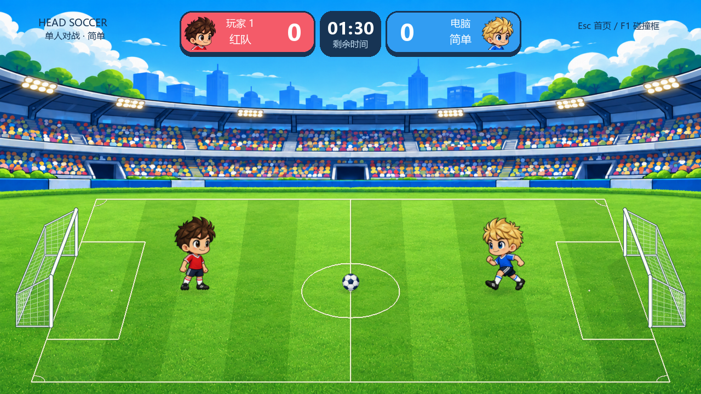

# 大头足球 · 我的 Python 游戏项目

一个用 Python + Pygame 制作的足球游戏学习项目。你可以与电脑比赛，也可以与朋友共用键盘对战；从修改一个参数开始，逐步理解条件判断、运动、碰撞和游戏 AI。



## 可以玩什么

- 单人对电脑：简单、中等、困难三档，电脑会追球、跑位和射门。
- 本地双人：上下左右自由跑位、斜向移动和踢球，没有跳跃。
- 每局 90 秒，进球更多的一方获胜；支持重新比赛和返回首页。
- 规则型 AI 在本地运行，安装依赖后游戏可离线玩，无须 API Key。

## 快速开始

先下载并解压完整项目，或用 GitHub Desktop 克隆。在包含 main.py 的文件夹打开终端。建议使用 Python 3.13；当前验证环境是 Windows / Python 3.13.3 / Pygame 2.6.1。

### Windows（PowerShell）

```powershell
python -m venv .venv
.venv\Scripts\python.exe -m pip install -r requirements.txt
.venv\Scripts\python.exe main.py
```

### macOS（终端）

```sh
python3 -m venv .venv
.venv/bin/python -m pip install -r requirements.txt
.venv/bin/python main.py
```

第一次执行以上三行；以后只执行最后一行。游戏入口始终是 **main.py**，不需要 bat 文件。Mac 上需要重新创建虚拟环境；当前尚未完成 Mac 实机验证。

详细安装与故障排查见 [学生使用指南](docs/classroom/学生使用指南.md)。

## 操作与规则

| 操作 | 红队 / 玩家 1 | 蓝队 / 玩家 2 |
|---|---|---|
| 移动与瞄准 | WASD | 方向键 |
| 踢球 | 空格 | Enter |

单人模式蓝队由电脑控制。红队攻右门，蓝队攻左门；整球越过门口计分。接触足球可带球，靠近并瞄准后才能踢到；松开方向键会记住最后方向。

首页鼠标选模式与难度，也可用 Tab 切模式、1/2/3 选难度、空格开始。比赛结束按 R 再来一局，Esc 返回首页并重置本局。按 F1 可查看碰撞范围。

## 从这里开始学习

1. 玩一局简单档，观察电脑的动作。
2. 阅读 ai_settings.py，找到简单档 reaction 参数。
3. 打开 ai.py，理解 should_defend 中的 and 判断。
4. 完成 [学生练习](docs/classroom/学生练习.md)，把预测和观察写入 [学习记录](docs/classroom/学习记录.md)。

| 文件 / 目录 | 作用 |
|---|---|
| main.py | 游戏入口，连接输入、规则和画面 |
| ai_settings.py / ai.py | 难度参数和电脑决策 |
| player.py / ball.py | 球员与足球 |
| collision.py / match.py | 碰撞、进球、计时和胜负 |
| settings.py | 场地和基础参数 |
| field.py / scenery.py / resources.py / ui.py | 投影、场景、资源和界面 |
| assets/images/ | 运行必需图片，必须一起提交 |
| docs/ | 使用说明与学习材料 |
| tests/ / tools/ | 自动检查与辅助工具 |

## 师生一起开发

仓库由学生创建并拥有，教师以协作者身份参与。按 [GitHub 师生协作教程](docs/classroom/GitHub师生协作教程.md) 完成创建、邀请与同步；提交前阅读 [提交范围与检查清单](docs/classroom/GitHub提交清单.md)。

开始修改前先同步，完成一个小任务后运行检查、提交并推送。不要上传 .venv、缓存或交付 ZIP；不要忽略运行图片。学生的练习代码和学习记录可以一起提交。

已安装依赖后，Windows 检查命令：

```powershell
.venv\Scripts\python.exe -m unittest discover -s tests -v
```

Mac 使用 `.venv/bin/python -m unittest discover -s tests -v`。固定 AI 场景可运行 `tools/check_ai.py`；测试不代表真人胜率，难度还需试玩调整。

## 当前范围与后续方向

当前已支持单人 AI 与本地双人。暂停、自由训练、音效、联网对战和独立应用打包尚未实现；后续可以由学生选择一项逐步完成。

素材来源与版本说明见 [素材与版本说明](docs/classroom/素材与版本说明.md)。本项目尚未指定开源许可证。
