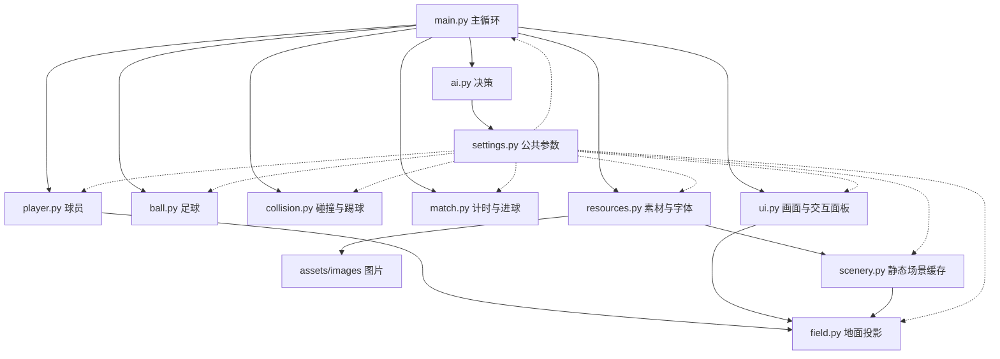

# 代码结构与阅读指南

## 目录

```text
headSoccer/
├── README.md              GitHub 首页：游戏介绍、截图、运行与学习入口
├── .gitignore             本地环境和生成物排除规则
├── .gitattributes         Windows / Mac 文本换行规范
├── main.py                运行入口、键盘鼠标输入、比赛状态与主循环
├── ai_settings.py         三档 AI 参数，学生优先修改入口
├── ai.py                  规则决策，输出移动与踢球意图
├── settings.py            场地范围、速度、尺寸、颜色等参数
├── field.py               地面世界坐标到屏幕的投影与远近缩放
├── scenery.py             缓存草地条纹、场线、白色球门的前后层
├── player.py              球员移动、瞄准、踢球动作状态和绘制
├── ball.py                足球滚动、摩擦、限速和旋转
├── collision.py           踢球命中、球员阻挡、轻推足球、边界碰撞
├── match.py               越线进球、计时和胜负规则
├── resources.py           图片与中文字体加载，基于文件位置找资源
├── ui.py                  场景贴图、遮挡排序、软阴影、近球方向提示和界面
├── requirements.txt       游戏依赖
├── assets/
│   ├── images/            游戏贴图（含保留的旧版导出图）
│   └── source/            制作源图与 reference/ 初始参考图
├── tools/
│   ├── prepare_assets.py  教师素材导出工具，正常游戏无需运行
│   └── preview.py         无窗口生成首页、比赛、近球、球门及边缘截图
├── tests/test_game.py     物理、规则、输入与状态流程检查
└── docs/                  所有使用说明、设计、结构文档及截图
    ├── README.md          从这里阅读运行与操作说明
    ├── 玩法设计.md
    ├── 代码结构.md
    ├── 验证记录.md
    ├── assets/            素材来源与原始提示词
    ├── previews/          当前截图
    ├── visual-comparisons/ 视觉方案与实际落地截图档案
    └── archive/           历史文档与旧版截图
```

核心文件保留在根目录，方便学生从 main.py 跟进各个模块，无需先理解 Python 包结构。docs、tools、tests 和素材制作源图都不参与普通游戏主循环。

## 模块关系



collision.py 接收 Player 和 Ball 对象并更新它们，不负责读取键盘或绘图。match.py 根据球的位置与时间返回结果，不操作界面。field.py 只负责显示转换，物理不把投影后的位置写回对象。

资源加载时，resources.py 读取 stadium_b_clean.png，然后调用 scenery.build_scenery 一次性制作场线、条纹和球门缓存。比赛过程中直接贴图，不逐帧重画高分辨率球网。球门前层独立缓存，在 ui.draw_scene 中参与纵深排序。

## 一帧的执行顺序

1. main.run 读取事件：开始、重开、回首页以及本帧踢球请求。
2. 检查真实经过的时间；到时先结束比赛。
3. read_directions 读取两位玩家的方向组合；将本帧方向交给 Player.kick 锁定射门朝向。
4. update_physics 把一帧拆成六个小步：球员移动 → 球员互相推开 → 球滚动 → 主动踢球与身体轻推 → 边界反弹 → 进球判断。
5. 若进球，进入庆祝状态并暂停运动；一秒后重置场上位置。若到时，进入结果页。
6. 绘制看台和场地 → 阴影 → 按纵深排序的球员、球和球门前框 → 特效 → 计分板与菜单。

## 三类位置不要混用

- `Player.x/y`：人物脚底的地面位置，不是图片左上角。
- `Ball.x/y`：足球的地面中心，不是屏幕上的足球图片中心。
- `project(x, y)`：仅绘制时使用。图片高度、脚底偏移、显示半径都属于视觉处理。

改变透视时修改 field.py；改变运动速度和碰撞大小时修改 settings.py。这样不会因为图片远小近大就造成不同位置射门力度不同。

## 学生阅读建议

1. settings.py：改速度、比赛时间，观察效果。
2. match.py：条件判断、函数返回值、完整越线条件。
3. player.py：二维向量、斜向归一化、移动与瞄准状态。
4. ball.py：速度与位移、摩擦。
5. main.py：主循环、状态切换和功能组合。
6. field.py、scenery.py 与 ui.py：地面投影、静态场景缓存、排序和动态绘制。

collision.py 先作为教师基础设施。可在 F1 模式下观察脚下碰撞圈和踢球扇形，再讲距离、点积、法向量与反弹。

## 常见修改入口

| 需求 | 文件 |
|---|---|
| 改键位 | main.py 的 read_directions 和事件处理，同时更新 ui.py 提示 |
| 改跑速、球速、冷却、球门宽度 | settings.py |
| 改斜射规则或命中范围 | player.py、collision.py |
| 改远近缩放或纵深压缩 | field.py |
| 换角色图片、支持其他字体 | resources.py、assets/images |
| 改场线、草地条纹、球门外观 | scenery.py |
| 改方向提示、菜单和计分板 | ui.py |
| 改比赛时长、进球或胜负规则 | settings.py、match.py |

## 运行与检查

从项目根目录执行 `python main.py`。资源路径按 resources.py 所在目录解析，因此从其他工作目录使用 main.py 的绝对路径启动也能读取素材。

测试：`python -m unittest discover -s tests -v`。
预览：`python tools/preview.py`。工具自动定位项目根目录，无需把工具移回根目录。

## 单人 AI 与课堂材料（2026-10-01 更新）

main.run 默认单人简单档；首页选择决定是否创建 AIController。AI 只替换蓝队输入，碰撞、进球和踢球仍共用原规则。Player.speed 默认为 PLAYER_SPEED，电脑按难度乘速度比例；进球复位时清空 AI 旧目标。

tests/test_ai.py 覆盖电脑行为和模式，tools/check_ai.py 跑固定场景。tools/package_student.py 生成白名单学生包；deliverables 存放交付 ZIP。docs/classroom 存放使用、协作、任务书、课堂流程、练习和独立教师答案。学生包只包含必要运行素材和学生文档。
